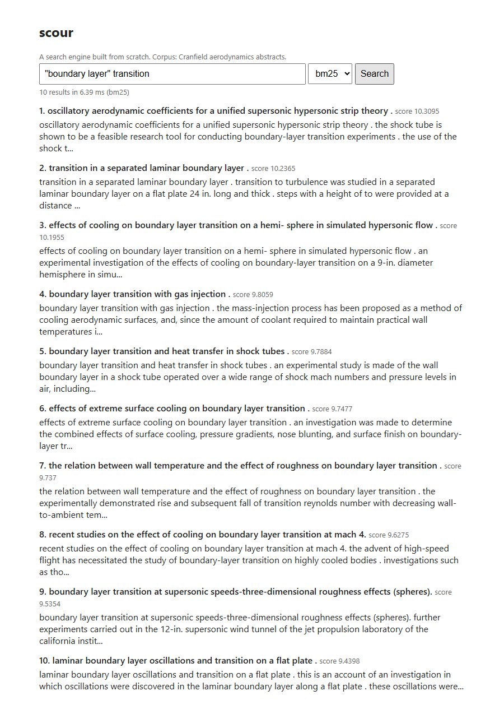

# Scour

[](https://github.com/tanviwadgaonkar/scour/actions/workflows/ci.yml) [](https://github.com/tanviwadgaonkar/scour/actions/workflows/benchmark-neural.yml)

A search engine built from scratch in Python: tokeniser, inverted index, BM25 ranking, quoted phrase queries, then dense retrieval, hybrid fusion and a cross-encoder reranker on top, all measured on a public IR benchmark with the same harness.

No search libraries for the core. The point was to build every stage myself and measure whether each one actually helps.

```
                 ┌─> BM25 over inverted index ─┐
query ──> tokenizer                            ├─> RRF fusion ──> cross-encoder rerank (top 50) ──> top-k
                 └─> cosine over dense index ──┘
```



*The bundled UI running locally (`uvicorn scour.api:app`), BM25 mode, query `"boundary layer" transition`. The phrase filter also matches the hyphenated "boundary-layer", because the tokenizer splits on non-alphanumerics.*

## Quick start

```bash
pip install -e ".[dev]"
pytest                                   # 48 tests, offline, a few seconds

python -m scour.eval.cranfield           # downloads the Cranfield collection to data/cranfield
python -m scour index  --docs data/cranfield/docs.jsonl --out index.pkl
python -m scour search --index index.pkl '"boundary layer" transition'
python -m scour.eval.run --data data/cranfield

pip install -e ".[neural]"               # sentence-transformers, downloads two small models on first run
python -m scour.eval.run --data data/cranfield --neural

pip install -e ".[api]"
SCOUR_DATA=data/cranfield uvicorn scour.api:app   # http://127.0.0.1:8000
```

## Results on Cranfield (1,400 docs, 225 queries)

Output of `python -m scour.eval.run --data data/cranfield --neural`, run by the [neural benchmark workflow](.github/workflows/benchmark-neural.yml) on a GitHub-hosted `ubuntu-latest` CPU runner:

| Ranker | P@10 | R@10 | MAP | nDCG@10 | p50 ms | p95 ms |
|---|---|---|---|---|---|---|
| TF-IDF (baseline) | 0.184 | 0.310 | 0.226 | 0.284 | 0.44 | 0.63 |
| BM25 (k1=1.5, b=0.75) | 0.232 | 0.389 | 0.276 | 0.348 | 0.73 | 1.22 |
| Dense (all-MiniLM-L6-v2) | 0.248 | 0.419 | 0.321 | 0.383 | 12.98 | 20.76 |
| **Hybrid (BM25 + dense, RRF)** | **0.264** | **0.438** | **0.340** | **0.408** | 17.93 | 24.00 |
| Hybrid + cross-encoder rerank (top 50) | 0.250 | 0.405 | 0.308 | 0.378 | 1983.41 | 2162.85 |

Index build: 0.13 s for 1,400 docs / 7,437 terms; embedding the corpus: 25 s. Latency is per query, single-threaded, CPU only. The lexical rows are also re-run on every push by the main CI workflow and match a local Windows run exactly.

**What the numbers say**

- **BM25 beats TF-IDF by +0.064 nDCG@10** (0.348 vs 0.284): term-frequency saturation and length normalisation matter.
- **Dense retrieval beats BM25** (0.383), and **hybrid RRF beats both** (0.408): the two rankers fail on different queries, so fusing ranks helps — at ~18 ms per query.
- **The cross-encoder reranker makes results worse** here (0.378 < 0.408) and costs ~2 s per query. The `ms-marco-MiniLM-L-6-v2` model is trained on web search queries; Cranfield is 1960s aerodynamics abstracts with very technical queries. A reranker is only an improvement if it fits the domain — so the default API mode stays BM25 / hybrid, and this is reported rather than hidden.
- **Indexing titles helps BM25:** with `--text-only` (bodies only), BM25 drops to nDCG@10 0.334 and MAP 0.266. Cranfield abstracts repeat their title, so indexing it again works as a 2× title-field boost.

## Design decisions

**Titles indexed with the body, with a gap.** Both rankers see title + text (dense always embedded `title. text`; BM25 previously indexed only the body, which made the comparison unfair). A one-position gap between title and body stops a quoted phrase from matching across the boundary.

**Caches that can't go stale.** The dense-embedding cache stores a SHA-256 fingerprint of the corpus and the model name and is rebuilt when either changes; index pickles carry a format version. Previously a changed corpus silently reused old vectors (or crashed the API with a `KeyError`).

**Verified benchmark data.** The Cranfield archive is downloaded over HTTPS and checked against a pinned SHA-256 before conversion, so every number above refers to the same bytes.

**Inverted index with positions, not a document-term matrix.** A matrix over 1,400 docs and a few thousand terms is almost entirely zeros. The index stores only the terms each document actually contains, and keeps term positions so phrase queries can check adjacency without re-reading the document.

**BM25 over TF-IDF.** TF-IDF keeps rewarding a term every time it repeats, and it does not care that a long document has more chances to match. BM25 adds term-frequency saturation (`k1`) and length normalisation (`b`). The results table shows what that is worth on this collection.

**Stopwords removed before positions are assigned.** Phrase matching runs on the same token stream the index was built from, so the behaviour is consistent even though "flow of the fluid" and "flow fluid" become the same phrase. That is a deliberate trade for a smaller index.

**Phrase filtering after scoring, not instead of it.** A quoted phrase decides which documents are allowed in; BM25 still decides their order. Candidate documents are intersected starting from the rarest term so the adjacency check touches as few postings as possible.

**Hybrid via reciprocal rank fusion, not score addition.** BM25 scores and cosine similarities are on different scales, so adding them means one ranker silently dominates. RRF combines ranks, needs no tuning, and rewards documents both rankers agree on.

**Reranker after retrieval, not instead of it.** A cross-encoder reads the query and document together and is far more accurate than comparing two embeddings, but it costs one forward pass per pair. Scoring the top 50 from the hybrid stage is affordable; scoring all 1,400 per query is not.

**Deterministic ranking.** Ties are broken on doc id so the same query always returns the same order, which matters when comparing evaluation runs.

## Layout

```
scour/
  tokenizer.py   lowercase, split, stopwords
  index.py       InvertedIndex: postings with tf and positions, save/load
  bm25.py        BM25 scorer
  tfidf.py       TF-IDF baseline
  search.py      SearchEngine: BM25 + quoted phrase filtering
  dense.py       DenseIndex: sentence-transformer embeddings, cosine search
  hybrid.py      reciprocal rank fusion
  rerank.py      cross-encoder second stage
  api.py         FastAPI: /search endpoint and a one-page UI
  __main__.py    CLI: index / search
  eval/
    metrics.py   P@k, R@k, MAP, nDCG@k
    cranfield.py download and convert the Cranfield collection
    run.py       evaluate rankers, print a Markdown table
tests/           pytest suite covering every module
```

## Roadmap

- [x] Stage 1: tokeniser, inverted index, BM25, phrase queries, evaluation harness, CI
- [x] Stage 2: dense retrieval, hybrid fusion (RRF), cross-encoder reranking, FastAPI demo, Dockerfile
- [x] Benchmark results above, reproduced in CI; Docker image built and smoke-tested in CI
- [ ] Stage 3: Porter stemmer as a measured change; k1/b sweep; latency benchmark script
- [ ] Stage 4: autocomplete (trie, top-k by frequency, edit-distance typo tolerance)
- [ ] Stage 5: compressed postings (delta + varint) and index size comparison

## Deployment

The Docker image builds the index at start-up and serves BM25 search, with `/health` for health checks. `render.yaml` is a Render Blueprint for the free web-service tier: in Render, choose **New → Blueprint**, select this repo, and deploy. Neural modes stay off in that image (`SCOUR_NEURAL=0`), because torch and two models don't fit a free instance's memory. CI builds the same image and smoke-tests `/search` on every push.

```bash
docker build -t scour . && docker run -p 8000:8000 scour     # http://localhost:8000, /health, /docs
```

No public demo is deployed yet.

## Known limitations

- No stemming yet: "transitions" doesn't match "transition" (Stage 3 on the roadmap).
- The index is rebuilt in memory at start-up; that's fine for 1,400 documents but not for millions (no on-disk segments or compression yet).
- The cross-encoder reranker is out of domain for Cranfield and lowers quality (see Results).
- Cranfield is small and old; results here don't transfer automatically to web-scale or modern corpora.

## Security notes

The demo UI escapes everything it inserts into the page (titles and snippets come from whatever corpus `SCOUR_DATA` points at). The Docker image runs as a non-root user. Index files are pickles: only load ones you built.

## Benchmark notes

Cranfield relevance codes run 1 (complete answer) to 4 (minimal interest); they are mapped to gains 4..1 so nDCG rewards the best documents most. Query ids in `cranqrel` are the 1-based position of the query in `cran.qry`, not the `.I` number printed in the file. The converter handles both; see `scour/eval/cranfield.py`.
